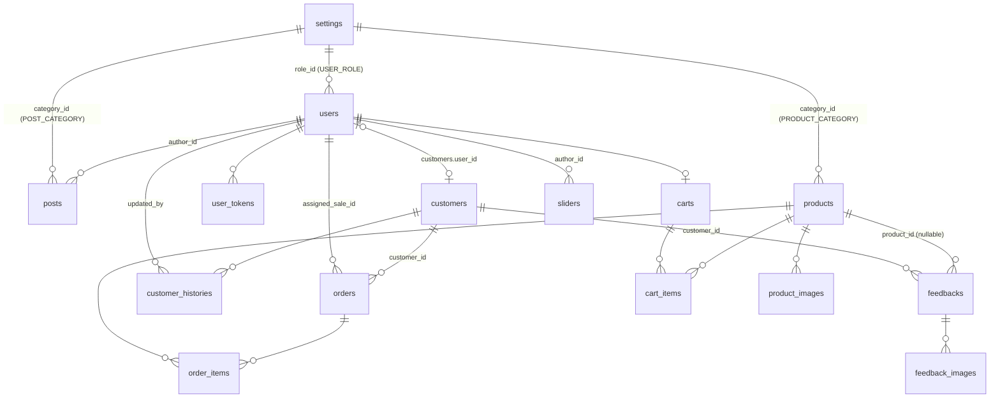

# OnlineShop — Project Guide

Tài liệu chuẩn của dự án, viết cho **thành viên nhóm và AI coding assistant của họ**.
Trước khi viết code cho bất kỳ chức năng nào, AI phải đọc hết file này và tuân thủ mọi quy tắc ở mục 0.

Nguồn yêu cầu: `OnlineShop_Requirements.pdf` (sơ đồ 36 màn hình) và [OnlineShop_Function Details.xlsx](OnlineShop_Function%20Details.xlsx) (mô tả chi tiết từng chức năng, đánh số #1–#36). Số thứ tự `#n` trong tài liệu này khớp với số thứ tự trong file Excel.

---

## 0. Quy tắc bất biến (KHÔNG được vi phạm)

1. **Không sửa entity và enum.** Không thêm, xoá hay đổi tên class, field, annotation mapping trong `entity/`; không thêm, xoá hay đổi tên hằng trong `enums/`.
2. **Không sửa migration.** `V1__init_schema.sql` và `V2__seed_data.sql` là cố định. `spring.jpa.hibernate.ddl-auto` luôn là `validate`. Nếu thật sự cần đổi schema, báo trưởng nhóm. Không tự thêm `V3`.
3. **Không đổi cấu trúc thư mục.** Không tạo package Java mới ngoài các package ở mục 2, không đổi tên hay di chuyển template có sẵn.
4. **Không thêm dependency Maven** khi chưa thống nhất với cả nhóm.
5. **Không xoá cứng dữ liệu nghiệp vụ.** `users`, `customers`, `posts`, `sliders`, `products`, `settings`, `orders`, `feedbacks` chỉ được ẩn hoặc khoá (`visible`, `active`, `status`). Chỉ các dòng phụ sau được xoá cứng: `cart_items`, `product_images`, `feedback_images`, `user_tokens`.
6. **Controller không gọi Repository trực tiếp.** Luồng gọi luôn là Controller → Service (interface) → ServiceImpl → Repository.
7. **Không bind entity trực tiếp từ form.** Form luôn bind vào DTO trong `dto/request` có Bean Validation, sau đó Service mới copy sang entity.
8. Mọi luồng ghi nhiều bảng (mục 8) phải nằm trong **một** method `@Transactional` của Service.
9. Kiểm tra quyền **ở cả URL lẫn dữ liệu.** Ví dụ: Sale chỉ được xem đơn có `assigned_sale_id` là chính mình; Customer chỉ được xem đơn của chính mình.

Được phép thêm: class mới trong các package có sẵn, template fragment trong `templates/fragments/`, file `templates/error.html`, file CSS/JS/ảnh trong `static/`, key cấu hình `app.*` mới (ghi bổ sung vào mục 3).

---

## 1. Tech stack

| Thành phần | Công nghệ |
|---|---|
| Ngôn ngữ | Java 21 |
| Framework | Spring Boot 4.1.2: Spring MVC + Thymeleaf (render phía server, **không** phải REST/SPA) |
| Bảo mật | Spring Security: form login, HttpSession, BCrypt, `thymeleaf-extras-springsecurity6` |
| Dữ liệu | Spring Data JPA (Hibernate), SQL Server, Flyway |
| Khác | Spring Mail (Gmail SMTP), Bean Validation, Lombok |

Cách chạy: tạo database rỗng `OnlineShopDB` trong SQL Server rồi chạy `./mvnw spring-boot:run`. Flyway sẽ tự tạo bảng và seed dữ liệu.

Tài khoản seed, tất cả có mật khẩu `123456`:

| Email | Role |
|---|---|
| `admin@onlineshop.com` | ADMIN |
| `marketing@onlineshop.com` | MARKETING |
| `salemanager@onlineshop.com` | SALE_MANAGER |
| `sale@onlineshop.com`, `sale2@onlineshop.com` | SALE |
| `customer@onlineshop.com` | CUSTOMER |

---

## 2. Cấu trúc thư mục và quy ước đặt tên

```
src/main/java/com/swd392/onlineshop/
├── OnlineShopApplication.java
├── config/          SecurityConfig, WebMvcConfig (map /uploads/**), AppProperties (@ConfigurationProperties "app"),
│                    GlobalModelAdvice (@ControllerAdvice: dữ liệu header/sider), LoginSuccessHandler
├── controller/
│   ├── publicsite/  HomeController, BlogController, ProductController, CartController, FeedbackController
│   ├── auth/        AuthController (login, register, verify, reset, rescue), ProfileController (profile, change password)
│   ├── customer/    MyOrderController
│   ├── marketing/   MktDashboardController, MktPostController, MktSliderController, MktProductController,
│   │                MktCustomerController, MktFeedbackController
│   ├── sales/       SaleDashboardController, SaleOrderController
│   └── admin/       AdminDashboardController, AdminUserController, AdminSettingController
├── dto/
│   ├── request/     Form nhập liệu: XxxForm (RegisterForm, ReceiverForm, PostForm...), XxxFilter (tham số lọc của list)
│   └── response/    Dữ liệu hiển thị: XxxRow (1 dòng của list), XxxView (trang chi tiết), DashboardXxx, CartLine
├── entity/          15 entity + BaseEntity (CỐ ĐỊNH)
├── enums/           6 enum (CỐ ĐỊNH)
├── exception/       BusinessException, NotFoundException, OutOfStockException, ForbiddenException, GlobalExceptionHandler
├── repository/      Mỗi entity 1 repository: XxxRepository extends JpaRepository<Xxx, Long> (+ JpaSpecificationExecutor cho list có filter)
└── service/         Interface XxxService
    └── impl/        XxxServiceImpl (@Service, @Transactional)

src/main/resources/
├── application.properties
├── db/migration/    V1__init_schema.sql, V2__seed_data.sql (CỐ ĐỊNH)
├── static/          css/style.css, js/, images/ (ảnh tĩnh và ảnh seed)
└── templates/
    ├── fragments/   header.html, footer.html, public-sider.html, staff-menu.html, pagination.html
    ├── public/ auth/ customer/ marketing/ sales/ admin/   (36 template, xem mục 9)
    └── error.html   trang lỗi chung (lỗi kỹ thuật, hết hàng, 403, 404)
```

**Quy ước:**
- Controller ở các nhóm khác nhau phải có tên class khác nhau, vì bean name của Spring là duy nhất. Vì vậy dùng tiền tố `Mkt`, `Sale`, `Admin`.
- Service dự kiến: `AuthService`, `UserService`, `TokenService`, `EmailService`, `FileStorageService`, `SettingService`, `PostService`, `SliderService`, `ProductService`, `CartService`, `OrderService`, `CustomerService`, `FeedbackService`, `DashboardService`.
- View name là đường dẫn template bỏ phần `.html`, ví dụ `return "public/products/product-list";`.
- Sau mỗi POST thành công phải **redirect** (pattern PRG) và đặt flash attribute `successMessage` hoặc `errorMessage`. Khi POST bị lỗi validate thì render lại chính template đó kèm lỗi.
- Mọi form dùng `th:action` để Thymeleaf tự chèn CSRF token. Logout là `POST /auth/logout`.
- Phân trang: tham số URL `page` bắt đầu từ 1 (đổi sang 0-based khi tạo `Pageable`). Kích thước trang lấy từ `app.page-size`.
- Sắp xếp: tham số `sort=<field>` và `dir=asc|desc`. Service phải kiểm tra field theo **whitelist** của từng màn.
- Khi list cần dữ liệu của bảng quan hệ (category, author...), dùng `@EntityGraph` hoặc fetch join để tránh N+1.
- Tiền là `BigDecimal`, hiển thị dạng VND: `#numbers.formatDecimal(x, 0, 'POINT', 0, 'COMMA')` + " ₫". Ngày giờ hiển thị dạng `dd/MM/yyyy HH:mm`.
- Thông báo hiển thị cho người dùng viết bằng tiếng Việt. Comment trong code viết tiếng Việt không dấu, giống code hiện có.

**Lombok:** đã khai báo sẵn trong `pom.xml` (dependency `optional` + `annotationProcessorPaths` của `maven-compiler-plugin`), không cần thêm gì. IDE cần bật annotation processing: IntelliJ có sẵn plugin Lombok; VS Code cần extension "Language Support for Java" bản mới (đã hỗ trợ Lombok).

| Loại class | Annotation dùng | Không dùng |
|---|---|---|
| Entity (`entity/`) | `@Getter`, `@Setter`, `@NoArgsConstructor` (đúng như các entity hiện có) | `@Data`, `@ToString`, `@EqualsAndHashCode`, `@AllArgsConstructor`, `@Builder`. Lý do: `toString`/`equals`/`hashCode` sinh tự động sẽ chạm vào quan hệ LAZY, gây `LazyInitializationException` hoặc đệ quy vô hạn giữa 2 chiều quan hệ |
| Controller, Service impl, config, handler | `@RequiredArgsConstructor` + field `private final` (constructor injection), `@Slf4j` khi cần log | `@Autowired` trên field |
| DTO form (`dto/request`) | `@Getter`, `@Setter`, `@NoArgsConstructor`. Spring cần constructor rỗng và setter để bind form | `final` field |
| DTO hiển thị (`dto/response`) | `@Getter` + `@Builder` + `@AllArgsConstructor`, hoặc `@Data` | — |
| Exception (`exception/`) | Constructor viết tay gọi `super(message)` | — |

Log dùng `log.info/warn/error` qua `@Slf4j`, không dùng `System.out.println`.

**Pop-up:** Login (#10), Register (#11), Change Password (#13) và User Profile (#14) là pop-up (modal).
- Mỗi template tương ứng khai báo `th:fragment="modal"`, và `fragments/header.html` include các fragment này.
- Route GET của từng màn vẫn render một trang đầy đủ chứa modal đang mở. Trang này dùng khi Spring Security redirect người chưa login, và khi POST bị lỗi validate.

**Ảnh upload:**
- `FileStorageService.store(MultipartFile, folder)` lưu file vào `${app.upload.dir}/{folder}/{uuid}.{ext}` và trả về URL `/uploads/{folder}/{uuid}.{ext}`.
- DB chỉ lưu URL.
- Ảnh seed nằm ở `/images/...` trong `static/`.
- Các folder: `avatars`, `posts`, `sliders`, `products`, `feedbacks`.

---

## 3. Cấu hình (`application.properties`)

Dữ liệu "cấu hình 1 lần" (theo PDF mục 3.a) nằm dưới prefix `app.*`. Code đọc qua `AppProperties`, không hard-code giá trị.

| Key | Ý nghĩa |
|---|---|
| `app.base-url` | Dùng để tạo link tuyệt đối trong email |
| `app.page-size` | Số dòng mỗi trang của mọi list |
| `app.home.featured-size` | Số bài viết hot và số SP nổi bật ở Home |
| `app.sider.latest-size` | Số bài viết / SP mới nhất hiện ở sider |
| `app.token.verify-email-expiry-minutes` | Thời hạn link xác thực email |
| `app.token.reset-password-expiry-minutes` | Thời hạn link reset mật khẩu |
| `app.upload.dir` | Thư mục lưu ảnh upload (đã thêm vào `.gitignore`) |
| `app.payment.bank-name`, `.account-number`, `.account-name`, `.transfer-prefix` | Hướng dẫn thanh toán ở Cart Completion và email. Nội dung chuyển khoản là `{transfer-prefix} {orderId}` |
| `app.shop.hotline`, `.email`, `.address` | "Static contacts/links" ở sider và footer |

Dữ liệu do người dùng cấu hình (role, post category, product category, admin menu) **không** nằm trong file này. Chúng nằm trong bảng `settings` và được quản lý ở màn #35–#36.

---

## 4. Data model

Mọi bảng đều có `id` (BIGINT IDENTITY), `created_at`, `updated_at`, kế thừa từ `BaseEntity`. Hai cột thời gian do Hibernate tự set, không gán bằng tay.

### 4.1 Danh sách bảng

| Bảng (Entity) | Mục đích | Cột quan trọng |
|---|---|---|
| `settings` (Setting) | Dữ liệu cấu hình | `type` (SettingType), `name` (tên hiển thị), `value` (mã dùng trong code), `display_order`, `active`. UNIQUE(`type`,`value`) |
| `users` (User) | Tài khoản đăng nhập | `email` (UNIQUE, là username), `password` (BCrypt), `role_id` → settings(USER_ROLE), `status` (UserStatus) |
| `user_tokens` (UserToken) | Token trong link gửi qua email | `user_id`, `token` (UUID, UNIQUE), `type` (TokenType), `expires_at`, `used_at` |
| `customers` (Customer) | Contact / khách hàng, **định danh bằng email** | `email` (UNIQUE), `status` (CustomerStatus, hệ thống tự tính), `user_id` (nullable, liên kết 1-1 với tài khoản) |
| `customer_histories` (CustomerHistory) | Lịch sử thay đổi contact | Ảnh chụp email, full_name, gender, mobile, address **sau** khi đổi; `updated_by` → users (null = hệ thống); `created_at` = ngày cập nhật |
| `posts` (Post) | Bài viết blog | `category_id` → settings(POST_CATEGORY), `author_id`, `featured`, `visible` |
| `sliders` (Slider) | Banner ở Home | `image`, `backlink`, `display_order`, `visible` |
| `products` (Product) | Sản phẩm | `category_id` → settings(PRODUCT_CATEGORY), `original_price` (list price), `sale_price` (nullable), `stock_quantity`, `featured`, `visible`. Giá bán = `getCurrentPrice()` |
| `product_images` (ProductImage) | Ảnh đính kèm của SP | `product_id`, `image_url`, `display_order` |
| `carts` (Cart) | Giỏ của user đã login | `user_id` (UNIQUE) |
| `cart_items` (CartItem) | Dòng trong giỏ | `cart_id`, `product_id`, `quantity`. UNIQUE(`cart_id`,`product_id`). **Không lưu giá** |
| `orders` (Order) | Đơn hàng | `customer_id` → customers (**người đặt**), `receiver_*` (ảnh chụp thông tin người nhận), `total_amount`, `status` (OrderStatus), `assigned_sale_id` → users, `sale_note`. Ngày đặt = `created_at` |
| `order_items` (OrderItem) | Dòng của đơn | `product_id`, `product_name` và `unit_price` (ảnh chụp lúc đặt), `quantity` |
| `feedbacks` (Feedback) | Feedback | `customer_id` → customers, `product_id` (null = feedback chung), ảnh chụp contact (full_name, gender, email, mobile), `rating` 1–5, `content`, `visible` |
| `feedback_images` (FeedbackImage) | Ảnh của feedback | `feedback_id`, `image_url` |

### 4.2 Quan hệ



### 4.3 Phân biệt `User` và `Customer`

- `User` là **tài khoản đăng nhập** của mọi role.
- `Customer` là **contact** mà Marketing quản lý, bao gồm cả người chưa có tài khoản: Guest đặt hàng, người gửi feedback, người do Marketing thêm tay.
- Một User có role CUSTOMER sẽ được liên kết với đúng 1 Customer có cùng email (`customers.user_id`).
- Đơn hàng **không** nối thẳng với User. Danh sách **My Orders** là các đơn có `orders.customer.user = user đang login`.
- Thông tin cá nhân ở User Profile (bảng `users`) và thông tin contact (bảng `customers`) **độc lập** với nhau. Sửa profile không cập nhật `customers`.

### 4.4 Settings dùng trong code

| type | value có sẵn | Dùng ở |
|---|---|---|
| `USER_ROLE` | `ADMIN`, `MARKETING`, `SALE_MANAGER`, `SALE`, `CUSTOMER` | Authority của Spring Security = `"ROLE_" + value`. **5 value này cố định**: Admin chỉ được sửa `name`, `description`, `display_order`. Không được tạo USER_ROLE mới hay tắt role đang có |
| `POST_CATEGORY` | `NEWS`, `PROMOTION`, `GUIDE` | Lọc bài viết, sider của Blog |
| `PRODUCT_CATEGORY` | `PHONE`, `LAPTOP`, `ACCESSORY` | Lọc SP, sider, doanh thu theo category |
| `ADMIN_MENU` | `value` = URL, `name` = nhãn | Menu của Admin, sắp theo `display_order`, chỉ lấy các dòng `active = 1` |

Category bị tắt (`active = 0`) thì không hiện ở filter và sider nữa. Post và SP thuộc category đó vẫn giữ nguyên.

---

## 5. Role và phân quyền (#15 User Authorization)

| Prefix URL | Được truy cập |
|---|---|
| `/`, `/blogs/**`, `/products/**`, `/cart/**`, `/feedback/**`, `/auth/**`, `/css/**`, `/js/**`, `/images/**`, `/uploads/**`, `/error` | Tất cả, kể cả Guest |
| `/profile/**` | Mọi user đã login |
| `/my-orders/**` | `CUSTOMER` |
| `/marketing/**` | `MARKETING` |
| `/sales/**` | `SALE`, `SALE_MANAGER` |
| `/admin/**` | `ADMIN` |

- **Login:** `POST /auth/login` (Spring Security xử lý), tham số `email` và `password`. User được tải bằng `findByEmail`. Tài khoản chỉ `enabled` khi `status = ACTIVE`. Nếu login thất bại vì NOT_VERIFIED hoặc INACTIVE thì hiện thông báo riêng cho từng trường hợp.
- **Sau khi login** (`LoginSuccessHandler`):
  1. Gộp giỏ trong session vào giỏ DB (mục 8.3).
  2. Chuyển trang theo role:
     - ADMIN → `/admin/dashboard`
     - MARKETING → `/marketing/dashboard`
     - SALE và SALE_MANAGER → `/sales/dashboard`
     - CUSTOMER → trang trước đó, hoặc `/` nếu không có
- **Menu:** header dùng `sec:authorize="hasRole('...')"` để chỉ hiện link mà role đó được dùng. Menu Admin lấy từ settings `ADMIN_MENU`. Link bị ẩn trên menu vẫn phải bị chặn ở `SecurityConfig` nếu ai đó gõ URL trực tiếp.
- **Phân quyền theo dữ liệu**, kiểm tra trong Service. Nếu vi phạm thì ném `ForbiddenException` (trả 403) hoặc `NotFoundException`:
  - Customer chỉ xem, sửa hoặc huỷ đơn có `customer.user.id = mình`.
  - SALE chỉ xem và cập nhật đơn có `assigned_sale_id = mình`. Dashboard của SALE luôn bị ép lọc theo chính mình.
  - SALE_MANAGER xem được tất cả đơn, lọc được theo Sale, và giao lại đơn.
  - Admin không được tự đổi role hoặc tự khoá tài khoản của chính mình.

---

## 6. Status và vòng đời

### 6.1 `UserStatus` (bảng `users.status`)

```
Register ──► NOT_VERIFIED ──(click link VERIFY_EMAIL còn hạn)──► ACTIVE ◄──(Admin)──► INACTIVE
Admin tạo user ─────────────────────────────────────────────────► ACTIVE (hoặc INACTIVE nếu Admin chọn)
```
- Chỉ tài khoản ACTIVE mới đăng nhập được.
- Khi đăng ký lại bằng email đang ở trạng thái NOT_VERIFIED: cập nhật thông tin, tạo token mới và gửi lại link. Nếu email đó đang ACTIVE hoặc INACTIVE thì báo lỗi "Email đã tồn tại".

### 6.2 `OrderStatus` (bảng `orders.status`)

```
                ┌──────────► CANCELLED ◄──────────┐
                │ (Customer / Sale)               │ (Sale)
SUBMITTED ──► CONFIRMED ──► SHIPPING ──► SUCCESS
     (Sale)        (Sale)        (Sale)
```

| Từ | Sang | Ai được làm | Tác động phụ |
|---|---|---|---|
| (mới) | SUBMITTED | Hệ thống, ở Cart Completion | Trừ tồn kho, giao Sale xoay vòng, upsert contact, gửi email xác nhận (mục 8.4) |
| SUBMITTED | SUBMITTED (sửa đơn) | Customer chủ đơn | Hoàn tồn kho theo items cũ, trừ tồn kho theo items mới (mục 8.5) |
| SUBMITTED | CANCELLED | Customer chủ đơn, Sale được giao, Sale Manager | **Cộng lại tồn kho** |
| SUBMITTED | CONFIRMED | Sale được giao, Sale Manager | — |
| CONFIRMED | SHIPPING / CANCELLED | Sale được giao, Sale Manager | CANCELLED thì cộng lại tồn kho |
| SHIPPING | SUCCESS / CANCELLED | Sale được giao, Sale Manager | SUCCESS: gửi email hướng dẫn feedback từng SP và tính lại `customers.status`. CANCELLED (giao thất bại): cộng lại tồn kho |
| SUCCESS, CANCELLED | — | — | Trạng thái cuối, không đổi được nữa |

Customer chỉ được Update hoặc Cancel khi đơn đang **SUBMITTED**. Màn Order Details của Sale chỉ hiện những trạng thái kế tiếp hợp lệ theo bảng trên.

### 6.3 `CustomerStatus` (bảng `customers.status`): hệ thống tự tính, không ai sửa tay

```
CUSTOMER   nếu có ít nhất 1 đơn (orders.customer_id = contact) ở trạng thái SUCCESS
POTENTIAL  nếu không thoả điều kiện trên, nhưng có tài khoản (user_id != null) HOẶC có ít nhất 1 đơn bất kỳ (kể cả đơn đã huỷ)
CONTACT    các trường hợp còn lại (Marketing thêm tay, người gửi feedback, người nhận trong đơn của người khác)
```
Gọi `CustomerService.refreshStatus(customer)` sau mỗi sự kiện: tạo contact, liên kết User, đặt đơn, sửa hoặc huỷ đơn, đơn chuyển sang SUCCESS.

### 6.4 `UserToken`

- Token chỉ dùng được khi `used_at IS NULL` và `expires_at > now` (`isUsable()`). Dùng xong thì set `used_at = now`.
- Trước khi tạo token mới, xoá các token cùng `type` chưa dùng của user đó.

### 6.5 Cờ hiển thị (Show/Hide)

| Bảng.cột | Ý nghĩa khi = 0 |
|---|---|
| `posts.visible` | Ẩn khỏi Blogs List, Blog Details, Home |
| `sliders.visible` | Ẩn khỏi Home |
| `products.visible` | Ẩn khỏi Products List, Product Details, Home. Không thêm vào giỏ được, và bị chặn khi submit đơn |
| `feedbacks.visible` | Ẩn khỏi mọi chỗ hiển thị công khai |
| `settings.active` | Không dùng trong filter, sider hay menu |

---

## 7. Định dạng dữ liệu nhập (validation)

Đây là bảng nhóm đề xuất theo PDF mục 3.b, cần thầy duyệt. Ba nơi phải khớp nhau: **validation trong DTO, cách hiển thị, và độ dài cột trong DB**.

| Trường | Quy tắc |
|---|---|
| `fullName` | Bắt buộc, 2–100 ký tự |
| `email` | Bắt buộc, đúng định dạng email, tối đa 100 ký tự. Lưu dạng chữ thường và đã trim |
| `mobile` | `^0\d{9}$` (10 số, bắt đầu bằng 0). Bắt buộc ở Register, Cart Contact, Feedback |
| `gender` | MALE / FEMALE / OTHER. Bắt buộc ở Register, Cart Contact, Feedback |
| `address` | Tối đa 255 ký tự. Bắt buộc ở Register và Cart Contact |
| `password` (mật khẩu thô) | 6–32 ký tự, có ít nhất 1 chữ cái và 1 chữ số. Ô nhập lại phải trùng |
| `note` (đơn hàng), `sale_note` | Tối đa 500 ký tự |
| `title` (post, slider), `name` (product) | Bắt buộc, tối đa 255 ký tự |
| `briefInfo` | Tối đa 500 ký tự |
| `content` (post), `description` (product) | Bắt buộc |
| `backlink` | Tối đa 255 ký tự, là URL tương đối bắt đầu bằng `/` hoặc `http(s)://` |
| `originalPrice` | Bắt buộc, từ 0 đến 9.999.999.999.999 |
| `salePrice` | Không bắt buộc. Nếu có thì ≥ 0 và ≤ `originalPrice` |
| `stockQuantity` | Bắt buộc, ≥ 0 |
| `quantity` trong giỏ | Từ 1 đến `stockQuantity` hiện tại |
| `rating` | Số nguyên 1–5 |
| `content` (feedback) | Bắt buộc, 10–2000 ký tự |
| Ảnh upload | jpg/jpeg/png/webp, tối đa 5MB mỗi ảnh. Feedback tối đa 5 ảnh |
| Setting: `name`, `value` | Bắt buộc, tối đa 100 ký tự. (`type`, `value`) không trùng |
| Setting: `description` | Tối đa 500 ký tự |

---

## 8. Các luồng nghiệp vụ chính (ghi nhiều bảng)

### 8.1 Đăng ký và xác thực email (#11)
1. `POST /auth/register` với `RegisterForm` (fullName, gender, email, mobile, address, password, confirmPassword).
2. Kiểm tra email theo quy tắc ở 6.1.
3. **Ghi** `users` (role = setting USER_ROLE `CUSTOMER`, status = NOT_VERIFIED, password đã BCrypt).
4. **Ghi** `user_tokens` (VERIFY_EMAIL, hết hạn sau `app.token.verify-email-expiry-minutes`).
5. Gửi email chứa link `{base-url}/auth/verify?token=...`.
6. `GET /auth/verify?token=`: nếu token hợp lệ thì:
   - `users.status = ACTIVE`, `user_tokens.used_at = now`.
   - Tìm `customers` theo email. Nếu có thì set `user_id`. Nếu chưa có thì tạo Customer từ thông tin User và **ghi** `customer_histories` (updated_by = null).
   - `refreshStatus`, kết quả ít nhất là POTENTIAL.
   - Mở modal login kèm thông báo thành công.

### 8.2 Quên mật khẩu (#12, gồm màn Rescue Update)
1. `POST /auth/reset-password` (email). Nếu user tồn tại và ACTIVE: xoá token RESET_PASSWORD cũ, **ghi** `user_tokens` mới, gửi link `{base-url}/auth/rescue?token=...`. Dù email có tồn tại hay không, luôn hiện **cùng một thông báo** để không lộ email nào đã đăng ký.
2. `GET /auth/rescue?token=`: token hợp lệ thì hiện form `auth/password/rescue-update`; không hợp lệ thì báo link hết hạn.
3. `POST /auth/rescue` (token, newPassword, confirmPassword): **ghi** `users.password`, `user_tokens.used_at`.

### 8.3 Giỏ hàng (#6)
- **Guest:** giỏ nằm trong session attribute `CART` kiểu `LinkedHashMap<Long productId, Integer quantity>`, mất khi đóng trình duyệt.
- **User đã login:** giỏ ở `carts` và `cart_items`. Bảng `carts` được tạo lúc thêm SP lần đầu.
- **Lúc login:** gộp giỏ session vào giỏ DB (cộng số lượng, tối đa bằng tồn kho) rồi xoá giỏ session.
- **Dòng giỏ hiển thị** (`CartLine`): productId, name, thumbnail, `product.getCurrentPrice()` (**luôn là giá mới nhất**), quantity, thành tiền. SP đã bị ẩn hoặc không đủ tồn kho thì đánh dấu cảnh báo và không cho checkout.
- **Thêm SP:** `POST /cart/add` (productId, quantity mặc định 1). Nếu SP đã có trong giỏ thì cộng dồn số lượng.
- **Sửa số lượng và xoá:** `POST /cart/update`, `POST /cart/remove`.
- **Khi submit đơn thành công:** xoá hết items, cả trong DB lẫn trong session.

### 8.4 Đặt hàng: Cart Contact → Cart Completion (#7, #8)

`POST /cart/submit` với `ReceiverForm` (fullName, gender, email, mobile, address, note). Toàn bộ chạy trong `OrderService.placeOrder` (@Transactional):

1. Lấy các dòng giỏ. Giỏ rỗng thì redirect về `/cart`.
2. Với từng SP, đọc `products` với khoá ghi (`@Lock(PESSIMISTIC_WRITE)`). Nếu SP không `visible` hoặc `stock_quantity < quantity` thì ném `OutOfStockException`, hiện trang `error.html` kèm tên SP.
3. **Upsert contact người nhận** (`CustomerService.upsertFromReceiver`), tìm theo email:
   - Chưa có thì **ghi** `customers` (CONTACT) và `customer_histories` (updated_by = null).
   - Đã có và khác ít nhất một trong fullName, gender, mobile, address thì cập nhật `customers` và **ghi** `customer_histories`.
4. **Xác định người đặt** (`orders.customer_id`):
   - Nếu đã login: lấy Customer liên kết với User. Nếu chưa có Customer nào liên kết thì tìm theo email của User rồi liên kết, hoặc tạo mới.
   - Nếu là Guest: lấy Customer người nhận ở bước 3.
5. **Ghi** `orders`:
   - `status = SUBMITTED`, thông tin `receiver_*` lấy từ form, `note`.
   - `total_amount` = Σ (currentPrice × quantity).
6. **Ghi** `order_items` với `product_name` và `unit_price` = currentPrice tại thời điểm đặt.
7. **Trừ** `products.stock_quantity`.
8. **Giao đơn xoay vòng:**
   - Ứng viên là user có role `SALE` (không tính SALE_MANAGER) và `status = ACTIVE`.
   - Chọn người có `MAX(orders.created_at)` trong các đơn đã được giao **nhỏ nhất**. Người chưa từng được giao đơn nào được ưu tiên trước. Hoà nhau thì chọn `id` nhỏ hơn.
   - Gán vào `orders.assigned_sale_id`. Nếu không có Sale nào thì để null và Sale Manager giao tay.
9. `refreshStatus` cho Customer người đặt.
10. Xoá giỏ hàng.
11. **Sau khi commit** (`@TransactionalEventListener(AFTER_COMMIT)` hoặc gọi sau khi transaction kết thúc): gửi email xác nhận đơn kèm hướng dẫn thanh toán lấy từ `app.payment.*`. Gửi mail lỗi thì chỉ log, **không** rollback đơn.
12. Lưu `LAST_ORDER_ID` vào session rồi redirect `GET /cart/completion`. Trang này hiện mã đơn, tóm tắt đơn và hướng dẫn thanh toán.

Cart Contact (`GET /cart/contact`) tự điền form: nếu đã login thì lấy thông tin từ `users`; nếu đang sửa đơn thì lấy từ `orders.receiver_*`.

### 8.5 Customer sửa hoặc huỷ đơn (#17)
- **Update:** `POST /my-orders/{id}/update`. Chỉ cho phép khi đơn là của mình và đang SUBMITTED.
  1. **Thay toàn bộ** giỏ DB bằng items của đơn.
  2. Lưu `EDITING_ORDER_ID` vào session rồi redirect `/cart`. Trang giỏ hiện banner "Đang sửa đơn #id" và nút huỷ sửa (`POST /cart/cancel-edit`, xoá biến session này).
  3. Khi submit mà có `EDITING_ORDER_ID`, trong một transaction:
     - Kiểm tra lại đơn vẫn đang SUBMITTED.
     - **Cộng lại** tồn kho theo items cũ, rồi kiểm tra và **trừ** tồn kho theo items mới.
     - Thay `order_items`, cập nhật `receiver_*`, `note`, `total_amount`.
     - **Giữ nguyên** `assigned_sale_id` và `created_at`.
     - Upsert contact (bước 3 của 8.4), xoá giỏ và `EDITING_ORDER_ID`, gửi email cập nhật đơn.
- **Cancel:** `POST /my-orders/{id}/cancel`. Chỉ cho phép khi đơn là của mình và đang SUBMITTED: `status = CANCELLED`, **cộng lại** tồn kho, `refreshStatus`.
- **Re-buy:** gọi `POST /cart/add` với productId của dòng đó.
- **Feedback:** link tới `/feedback?productId=`.

### 8.6 Sale xử lý đơn (#31)
- `POST /sales/orders/{id}` (status, saleNote): chỉ Sale được giao hoặc Sale Manager. Kiểm tra trạng thái mới có hợp lệ theo bảng 6.2 không, rồi **ghi** `orders.status`, `orders.sale_note` và thực hiện tác động phụ:
  - CANCELLED: cộng lại tồn kho.
  - SUCCESS: gửi email cho `receiver_email`, mỗi SP kèm link `{base-url}/feedback?productId=...`, rồi `refreshStatus`.
- `POST /sales/orders/{id}/assign` (saleId): chỉ SALE_MANAGER. Sale được chọn phải có role SALE và ACTIVE. **Ghi** `orders.assigned_sale_id`.

### 8.7 Gửi feedback (#9)
`POST /feedback` với `FeedbackForm` (productId tuỳ chọn, fullName, gender, email, mobile, rating, content, images[]):
1. Nếu có productId thì SP phải tồn tại và `visible`.
2. Tìm `customers` theo email. Chưa có thì **ghi** `customers` (CONTACT) và `customer_histories`. Đã có thì **không** cập nhật contact.
3. **Ghi** `feedbacks` (`visible = 1`, contact info chụp từ form) và `feedback_images`.
4. Nếu đã login thì form được điền sẵn từ `users`.

### 8.8 Marketing quản lý contact (#25, #26)
- **Tạo mới:** **ghi** `customers`, sau đó `refreshStatus` (kết quả là CONTACT), rồi **ghi** `customer_histories` với `updated_by` = Marketing đang login.
- **Sửa** (fullName, gender, email, mobile, address; **không** có status): nếu có thay đổi thì **ghi** `customer_histories` với `updated_by` = Marketing đang login. Không cho đổi email khi contact đã liên kết tài khoản (`user_id != null`). Email mới không được trùng contact khác.

### 8.9 Danh sách email (`EmailService`)

| Sự kiện | Người nhận | Nội dung |
|---|---|---|
| Register | user | Link xác thực `/auth/verify?token=` |
| Reset password | user | Link `/auth/rescue?token=` |
| Admin tạo user | user mới | Mật khẩu ngẫu nhiên (10 ký tự) |
| Đặt hoặc sửa đơn | `receiver_email` | Mã đơn, danh sách SP, tổng tiền, hướng dẫn thanh toán (`app.payment.*`) |
| Đơn SUCCESS | `receiver_email` | Link feedback cho từng SP |

---

## 9. Chi tiết từng màn hình

Ký hiệu: **R** là bảng được đọc, **W** là bảng được ghi.

"Sider public" gồm ô tìm kiếm, danh sách category đang active, 5 bài viết hoặc SP mới nhất (`visible`, sắp theo `updated_at` giảm dần) và contact tĩnh (`app.shop.*`). Dữ liệu sider được cung cấp qua `GlobalModelAdvice` và hiển thị bằng `fragments/public-sider.html`.

### Public (Guest + mọi user)

**#1 Home Page**: `GET /` → `public/home/home`
- R: `sliders` (visible, sắp theo display_order), `posts` (visible và featured: "hot posts"; cộng sider bài mới nhất), `products` (visible và featured), `settings`.
- Click slider thì đi tới `backlink`. Click post thì đi tới `/blogs/{id}`. Click SP thì đi tới `/products/{id}`.

**#2 Blogs List**: `GET /blogs?keyword=&categoryId=&page=` → `public/blogs/blog-list`
- R: `posts` (visible; tìm keyword theo title; sắp theo `updated_at` giảm dần), `settings` (POST_CATEGORY).
- Mỗi bài hiện thumbnail, title, brief_info. Sider có ô tìm bài, danh sách category, bài mới nhất, contact.

**#3 Blog Details**: `GET /blogs/{id}` → `public/blogs/blog-details`
- R: `posts` (phải visible, nếu không thì 404), `users` (tác giả), `settings`.
- Hiện title, author, `updated_at`, category, content.

**#4 Products List**: `GET /products?keyword=&categoryId=&page=` → `public/products/product-list`
- R: `products` (visible; tìm keyword theo name; sắp theo `updated_at` giảm dần), `settings` (PRODUCT_CATEGORY).
- Mỗi SP hiện thumbnail, name, brief_info, original_price, sale_price. Nút **Buy** gọi `POST /cart/add`, nút **Feedback** đi tới `/feedback?productId=`.

**#5 Product Details**: `GET /products/{id}` → `public/products/product-details`
- R: `products` (phải visible), `product_images`, `settings`.
- Hiện title, category, các ảnh, giá gốc, giá sale, description. Có nút Buy và Feedback.

**#6 Cart Details**: `GET /cart` → `public/cart/cart-details`
- R: session `CART` hoặc `carts` + `cart_items`, cùng với `products`. W: như R.
- Tham khảo mục 8.3. Nút "Choose More Product" đi tới `/products`, nút "Check Out" đi tới `/cart/contact`.

**#7 Cart Contact**: `GET /cart/contact`, `POST /cart/submit` → `public/cart/cart-contact`
- R: giỏ, `products`, `users` (để điền sẵn form), `orders` (nếu đang sửa đơn).
- Nút "Change" quay về `/cart`. Submit theo mục 8.4.

**#8 Cart Completion**: `GET /cart/completion` → `public/cart/cart-completion`
- R: `orders` + `order_items` theo session `LAST_ORDER_ID`, cấu hình `app.payment.*`.
- W (lúc submit): `orders`, `order_items`, `products`, `customers`, `customer_histories`, `cart_items`.

**#9 Feedback**: `GET /feedback?productId=`, `POST /feedback` → `public/feedback/feedback`
- R: `products`, `users`. W: `customers`, `customer_histories`, `feedbacks`, `feedback_images`.
- Mở được từ menu header, nút Feedback ở #4, #5, #17, hoặc link trong email khi đơn SUCCESS. Tham khảo mục 8.7.

### Common

**#10 User Login** (pop-up): `GET /auth/login`, `POST /auth/login`, `POST /auth/logout` → `auth/login/login`
- R: `users`, `settings`. W: `cart_items` (gộp giỏ). Có link mở Register và Reset Password.

**#11 User Register** (pop-up): `GET|POST /auth/register`, `GET /auth/verify?token=` → `auth/register/register`
- W: `users`, `user_tokens`, `customers`, `customer_histories`. Tham khảo mục 8.1.

**#12 Reset Password**: `GET|POST /auth/reset-password` → `auth/password/reset-password`. **Rescue Update**: `GET|POST /auth/rescue` → `auth/password/rescue-update`
- R/W: `users`, `user_tokens`. Tham khảo mục 8.2.

**#13 Change Password** (pop-up): `GET|POST /profile/change-password` → `auth/password/change-password`
- W: `users.password`. Mật khẩu hiện tại phải khớp. Mật khẩu mới nhập 2 lần phải trùng nhau và khác mật khẩu hiện tại.

**#14 User Profile** (pop-up): `GET|POST /profile` → `auth/profile/profile`
- W: `users` (full_name, gender, mobile, address, avatar). **Không** cho sửa email. **Không** đụng tới `customers`.

**#15 User Authorization**: không có màn hình riêng. Tham khảo mục 5: `SecurityConfig`, `LoginSuccessHandler`, menu trong `fragments/header.html` và `fragments/staff-menu.html`.

### Customer

**#16 My Orders**: `GET /my-orders?page=` → `customer/orders/my-orders`
- R: `orders` (có `customer.user` = mình, sắp theo `created_at` giảm dần), `order_items`. Có sider public.
- Mỗi dòng: id (link sang #17), ngày đặt, tên SP đầu tiên + "và n SP khác", total_amount, status.

**#17 Order Information**: `GET /my-orders/{id}` → `customer/orders/order-information`
- R: `orders`, `order_items`, `products`, `settings`.
- Hiện id, ngày đặt, tổng tiền, status; thông tin người nhận (`receiver_*`); danh sách SP (thumbnail, name, category, unit_price, quantity, thành tiền) kèm nút **Re-buy** và **Feedback**.
- Đơn SUBMITTED có thêm nút **Update** và **Cancel** (mục 8.5). W: `orders`, `order_items`, `products`, `cart_items`.

### Marketing (`/marketing/**`)

**#18 MKT Dashboard**: `GET /marketing/dashboard?from=&to=` → `marketing/dashboard/dashboard`
- Khoảng ngày mặc định là 7 ngày gần nhất (hôm nay − 6 đến hôm nay), tính trên `[from 00:00, to + 1 ngày 00:00)`.
- R: `posts`, `products`, `customers`, `feedbacks`. Thống kê: số post, số SP, số contact mới và số feedback trong khoảng ngày, theo `created_at`. Biểu đồ: số contact mới theo từng ngày (`customers.created_at`).

**#19 Posts List**: `GET /marketing/posts` → `marketing/posts/post-list`
- Bộ lọc: `categoryId`, `authorId`, `visible`, `keyword` (tìm theo title).
- Sắp xếp: title, category, author, featured, visible.
- Cột: id, thumbnail, title, category, author, featured, status.
- Hành động: `POST /marketing/posts/{id}/toggle` (hiện/ẩn), View/Edit (đi tới #20), nút "Add new" (đi tới `/marketing/posts/new`).
- R: `posts`, `settings`, `users`. W: `posts.visible`.

**#20 Post Details**: `GET /marketing/posts/new|{id}`, `POST /marketing/posts` (tạo), `POST /marketing/posts/{id}` (sửa) → `marketing/posts/post-details`
- Trường: thumbnail (upload), category, title, brief_info, content, featured, visible.
- `author_id` = Marketing đang login khi tạo, không đổi khi sửa. W: `posts`.

**#21 Sliders List**: `GET /marketing/sliders` → `marketing/sliders/slider-list`
- Bộ lọc: `visible`, `keyword` (tìm theo title hoặc backlink). Cột: id, title, image, backlink, status.
- Hành động: hiện/ẩn, edit, add. W: `sliders.visible`.

**#22 Slider Details**: `.../sliders/new|{id}` → `marketing/sliders/slider-details`
- Trường: image (bắt buộc), title, backlink, notes, display_order, visible. `author_id` = Marketing đang login. W: `sliders`.

**#23 Products List**: `GET /marketing/products` → `marketing/products/product-list`
- Bộ lọc: `categoryId`, `visible`, `keyword` (tìm theo name hoặc brief_info).
- Sắp xếp: name, category, original_price, sale_price, featured, visible.
- Cột: id, thumbnail, name, category, list price, sale price, featured, status.
- Hành động: hiện/ẩn, view/edit, add. W: `products.visible`.

**#24 Product Details**: `.../products/new|{id}` → `marketing/products/product-details`
- Trường: thumbnail, category, name, brief_info, ảnh đính kèm (thêm hoặc xoá), description, stock_quantity, original_price, sale_price, featured, visible.
- W: `products`, `product_images`.

**#25 Customers List**: `GET /marketing/customers` → `marketing/customers/customer-list`
- Bộ lọc: `status` (CustomerStatus), `keyword` (tìm theo full_name, email hoặc mobile).
- Sắp xếp: full_name, email, mobile, status. Cột: id, full_name, gender, email, mobile, status.
- Hành động: add new, view/edit. **Không** có hiện/ẩn. R: `customers`.

**#26 Customer Details**: `.../customers/new|{id}` → `marketing/customers/customer-details`
- Trường sửa được: full_name, gender, email, mobile, address. Status chỉ hiển thị, không sửa được.
- Có bảng lịch sử (`customer_histories`, mới nhất lên đầu) với các cột: email, full name, gender, mobile, address, updated by (`updated_by.full_name`, hoặc "Hệ thống" nếu null), updated date (`created_at`).
- W: `customers`, `customer_histories` (mục 8.8).

**#27 Feedbacks List**: `GET /marketing/feedbacks` → `marketing/feedbacks/feedback-list`
- Bộ lọc: `visible`, `productId`, `rating`, `keyword` (tìm theo full_name hoặc content).
- Sắp xếp: full_name, tên SP, rating, visible. Cột: full_name, tên SP (hoặc "Feedback chung"), rating, status.
- Hành động: view, đổi trạng thái (`POST /marketing/feedbacks/{id}/toggle`). R: `feedbacks`, `products`.

**#28 Feedback Details**: `GET /marketing/feedbacks/{id}` → `marketing/feedbacks/feedback-details`
- Hiện full_name, email, mobile, SP, rating, content, ảnh (`feedback_images`), status. Chỉ cho đổi status, không sửa nội dung.
- W: `feedbacks.visible`.

### Sale / Sale Manager (`/sales/**`)

**#29 Sale Dashboard**: `GET /sales/dashboard?from=&to=&saleId=&status=` → `sales/dashboard/dashboard`
- Khoảng ngày mặc định là 7 ngày gần nhất. SALE luôn bị ép `saleId` = mình. SALE_MANAGER chọn được tất cả hoặc một Sale.
- R: `orders`, `users`. Biểu đồ theo từng ngày (`orders.created_at`):
  - Số đơn tổng: áp dụng bộ lọc `status` nếu có.
  - Số đơn SUCCESS.
  - Doanh thu = Σ `total_amount` của các đơn SUCCESS.

**#30 Orders List**: `GET /sales/orders` → `sales/orders/order-list`
- Phạm vi: SALE chỉ thấy đơn có `assigned_sale_id` = mình. SALE_MANAGER thấy tất cả.
- Bộ lọc: `from`, `to` (theo created_at), `saleId` (chỉ Sale Manager), `status`.
- Tìm kiếm: `keyword` là id đơn hoặc `customers.full_name`.
- Sắp xếp: created_at, tên khách, total_amount, status.
- Cột: id (link sang #31), ngày đặt, tên khách, SP đầu tiên + "và n SP khác", total_amount, status.

**#31 Order Details**: `GET /sales/orders/{id}` → `sales/orders/order-details`
- Thông tin đơn: id, tên, email và mobile của khách (lấy từ `orders.customer`), ngày đặt, tổng tiền, tên Sale, status.
- Người nhận: `receiver_*`. Danh sách SP: thumbnail, name, category, unit_price, quantity, thành tiền.
- Form cập nhật status và sale_note, chỉ dành cho Sale được giao hoặc Sale Manager. Form giao lại Sale, chỉ dành cho Sale Manager. Tham khảo mục 8.6.
- W: `orders`, `products` (khi huỷ đơn).

### Admin (`/admin/**`)

**#32 Admin Dashboard**: `GET /admin/dashboard?from=&to=` → `admin/dashboard/dashboard`. Khoảng ngày mặc định là 7 ngày gần nhất.
- Đơn mới trong khoảng: đếm theo SUCCESS, CANCELLED, SUBMITTED.
- Doanh thu (chỉ đơn SUCCESS): tổng, và theo product category. Doanh thu theo category = Σ `order_items.unit_price × quantity`, join `products.category_id`.
- Khách hàng: số user role CUSTOMER mới đăng ký (`users.created_at`); số contact mới mua (contact có đơn đầu tiên nằm trong khoảng).
- Feedback: rating trung bình tổng, và theo product category (chỉ tính feedback có product).
- Biểu đồ: số đơn tất cả và số đơn SUCCESS theo từng ngày.
- R: `orders`, `order_items`, `products`, `settings`, `users`, `customers`, `feedbacks`.

**#33 Users List**: `GET /admin/users` → `admin/users/user-list`
- Bộ lọc: `gender`, `roleId`, `status`. Tìm kiếm: `keyword` (full_name, email, mobile).
- Sắp xếp: id, full_name, gender, email, mobile, role, status. Cột: id, full_name, gender, email, mobile, role, status.
- Hành động: view/edit, add new. R: `users`, `settings`.

**#34 User Details**: `.../users/new|{id}` → `admin/users/user-details`
- Hiện avatar, full_name, gender, email, mobile, role, address, status.
- **Tạo mới:**
  - Nhập đủ các trường. Hệ thống sinh mật khẩu ngẫu nhiên rồi gửi email.
  - Nếu role là CUSTOMER thì liên kết hoặc tạo Customer giống bước verify ở 8.1.
- **Sửa:** chỉ được đổi `role_id` và `status`. Không được tự đổi role hoặc tự khoá chính mình.
- W: `users` (+ `customers`, `customer_histories`).

**#35 Settings List**: `GET /admin/settings` → `admin/settings/setting-list`
- Bộ lọc: `type`, `active`. Tìm kiếm: `keyword` (theo value).
- Sắp xếp: id, type, value, display_order, active. Cột: id, type, value, order, status.
- Hành động: view, activate/deactivate (`POST /admin/settings/{id}/toggle`), edit, add. W: `settings.active`.

**#36 Setting Details**: `.../settings/new|{id}` → `admin/settings/setting-details`
- Trường: type, name, value, display_order, description, active. Không cho (`type`, `value`) trùng nhau.
- Với USER_ROLE, áp dụng hạn chế ở mục 4.4. W: `settings`.

---

## 10. Checklist khi làm 1 chức năng (dành cho AI)

1. Tìm màn `#n` ở mục 9. Dùng **đúng** URL, template, bảng đọc/ghi và quy tắc đã ghi ở đó.
2. Nếu chức năng ghi nhiều bảng, làm đúng thứ tự trong luồng tương ứng ở mục 8, và đặt toàn bộ trong 1 method `@Transactional`.
3. Mọi lần đổi status phải theo bảng ở mục 6, kèm đủ tác động phụ (tồn kho, email, `refreshStatus`).
4. Dùng Lombok đúng bảng quy ước ở mục 2: inject bằng `@RequiredArgsConstructor` + `private final`, không dùng `@Data` trên entity.
5. Form dùng DTO trong `dto/request` với validation theo mục 7. Dữ liệu hiển thị dùng DTO trong `dto/response` hoặc entity đã fetch đủ dữ liệu.
6. Kiểm tra quyền ở URL (`SecurityConfig`) **và** ở dữ liệu (Service), theo mục 5.
7. Không sửa gì thuộc `entity/`, `enums/`, `db/migration/`. Nếu thấy thiếu field hay thiếu bảng thì **dừng lại và báo**, không tự tìm cách lách (ví dụ nhét JSON vào cột text, hay tự tạo bảng mới).
8. Chạy `./mvnw compile` trước khi commit. Nếu có database thì chạy app để Hibernate validate kiểm tra.
